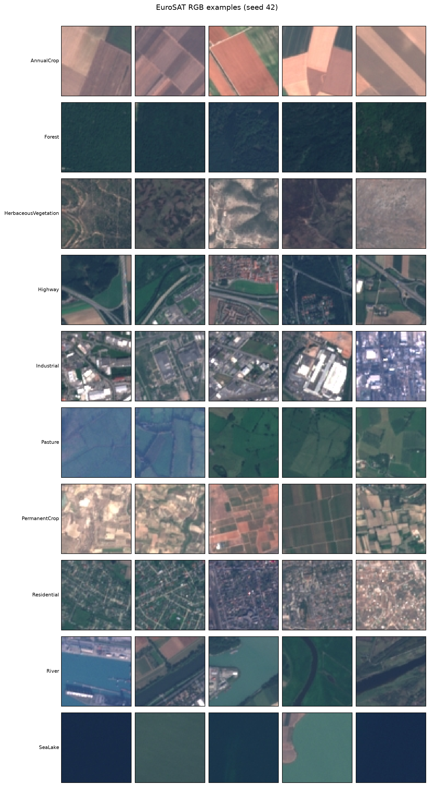
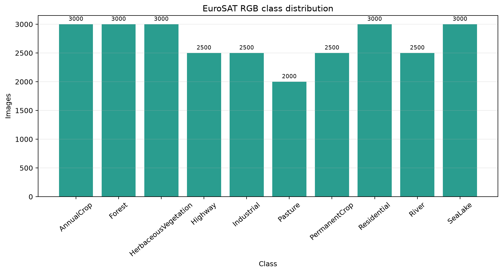
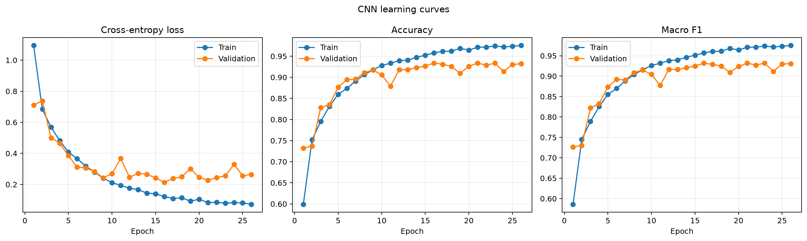
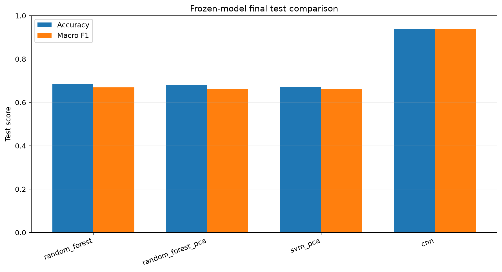
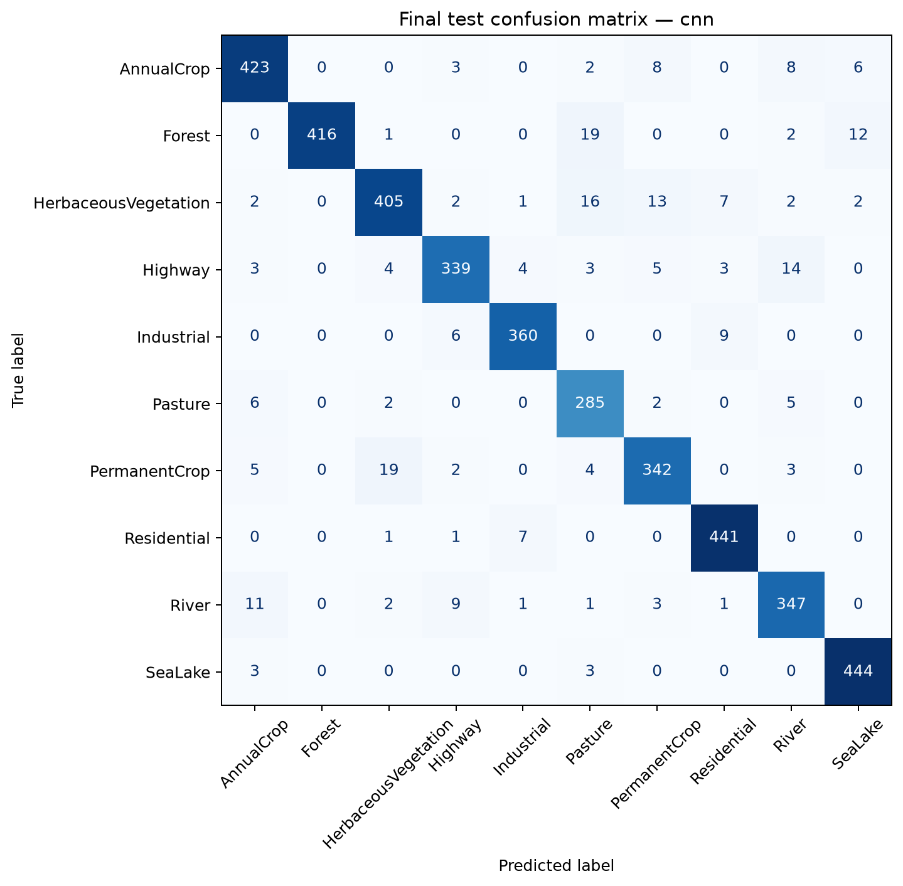

# CropVision: Machine Learning Approaches to Satellite Image Classification

**Course:** ITE351 — Artificial Intelligence and Applications  
**University:** Hanyang University, Seoul Campus  
**Semester:** Fall 2026  
**Project type:** Machine Learning research project

CropVision compares traditional machine-learning baselines with a compact convolutional neural network for land-use and land-cover classification from satellite images.

> **Research question:** How do traditional Machine Learning methods and a Deep Learning approach compare in satellite image classification?

## Table of Contents

- [Team Members](#team-members)
- [I. Introduction](#i-introduction)
- [II. Datasets](#ii-datasets)
- [III. Methodology](#iii-methodology)
- [IV. Evaluation & Analysis](#iv-evaluation--analysis)
- [V. Related Work](#v-related-work)
- [VI. Conclusion & Discussion](#vi-conclusion--discussion)

## Team Members

| Name | Department | University | Email |
|---|---|---|---|
| Malik SAADI | School of Computer Science | Hanyang University (exchange) | malik.saadi@edu.ece.fr |
| Edgar PRADET | School of Computer Science | Hanyang University (exchange) | edgar.pradet@edu.ece.fr |
| Etienne SIOEN | School of Computer Science | Hanyang University (exchange) | etienne.sioen@edu.devinci.fr |

---

## I. Introduction

### Motivation

Earth-observation satellites continuously produce images that can support agriculture, environmental monitoring, urban planning, and land-use mapping. Before these images can be used in larger decision-support systems, they must be transformed into meaningful categories. Manual interpretation does not scale well, so automatic image classification is an important remote-sensing task.

Satellite image classification is also a useful case study for comparing two families of Artificial Intelligence methods. Traditional machine-learning models usually require an explicit numerical representation of an image. Deep-learning models can instead learn spatial features directly from image pixels. The more complex approach is not automatically the best choice in every setting: prediction quality, training cost, memory use, interpretability, and implementation complexity all matter.

CropVision therefore evaluates three traditional pipelines—Random Forest, Random Forest with Principal Component Analysis (PCA), and a radial-basis-function Support Vector Machine (RBF SVM) with PCA—against a compact custom Convolutional Neural Network (CNN). All four selected models use the same image identities and are evaluated on the same held-out test set.

### Objectives

The project has five main objectives:

1. Build a deterministic and leakage-safe workflow for the EuroSAT RGB dataset.
2. Establish reproducible traditional ML baselines using flattened RGB pixels.
3. Measure whether PCA makes these high-dimensional baselines more practical or accurate.
4. Train a simple CNN that preserves the spatial structure of the images and remains manageable on an 8 GB Apple Silicon Mac.
5. Compare the selected models using accuracy, macro precision, macro recall, macro-F1, per-class scores, confusion matrices, training time, and inference time.

The goal is not to claim a new state of the art. It is to conduct a controlled comparison, explain the observed trade-offs, and make the complete experimental process reproducible.

## II. Datasets

### EuroSAT RGB

We use the **RGB version of EuroSAT**, introduced by Helber et al. [1] and documented in the [official EuroSAT repository](https://github.com/phelber/EuroSAT). EuroSAT is built from Sentinel-2 image patches and contains land-use and land-cover categories from locations across Europe. The selected release contains **27,000 JPEG images**, each with shape **64 × 64 × 3**, divided into **10 classes**. Only the visible red, green, and blue channels are used; the 13-band multispectral version is outside the scope of this project.

The archive is obtained from the documented [EuroSAT Zenodo record](https://zenodo.org/records/7711810) and checked against the MD5 value stored in [`configs/default.yaml`](configs/default.yaml). The preparation command decoded and inspected all 27,000 images, confirmed their RGB mode and dimensions, and verified the expected class counts.

*Figure 1. Five deterministic examples from each EuroSAT RGB class (seed 42). The visual similarity of some vegetation and built-environment classes already suggests that raw color values may be insufficient.*

### Class distribution

| Class | Total | Train | Validation | Test |
|---|---:|---:|---:|---:|
| AnnualCrop | 3,000 | 2,100 | 450 | 450 |
| Forest | 3,000 | 2,100 | 450 | 450 |
| HerbaceousVegetation | 3,000 | 2,100 | 450 | 450 |
| Highway | 2,500 | 1,750 | 375 | 375 |
| Industrial | 2,500 | 1,750 | 375 | 375 |
| Pasture | 2,000 | 1,400 | 300 | 300 |
| PermanentCrop | 2,500 | 1,750 | 375 | 375 |
| Residential | 3,000 | 2,100 | 450 | 450 |
| River | 2,500 | 1,750 | 375 | 375 |
| SeaLake | 3,000 | 2,100 | 450 | 450 |
| **Total** | **27,000** | **18,900** | **4,050** | **4,050** |

*Figure 2. EuroSAT RGB is moderately imbalanced: Pasture has 2,000 images, while five classes have 3,000. This motivates reporting macro-averaged metrics in addition to accuracy.*

### Deterministic split and integrity checks

The data were divided with a **stratified 70/15/15 split** and fixed seed **42**. The manifests contain 18,900 training, 4,050 validation, and 4,050 test identities. Automated audits confirmed:

- all 27,000 validated images occur in exactly one manifest;
- train/validation, train/test, and validation/test overlap counts are all zero;
- no manifest path is missing from or unknown to the validated dataset; and
- every class retains the intended split proportion.

The validation set was used for candidate selection and CNN checkpoint selection. Training commands did not decode test images. After all configurations were frozen, a separate guarded command evaluated the four selected artifacts on the test set once. Consequently, **validation results describe model selection, while test results estimate final generalization**.

## III. Methodology

### 1. Shared experimental protocol

All experiments use the same seed, class order, and split manifests. Learned preprocessing is fitted only on training data. Candidate configurations are compared using **validation macro-F1**, which gives equal importance to every class despite different class sizes. The final test set is never used to select a model, preprocessing method, hyperparameter, or checkpoint.

The traditional models receive each image as a flattened vector of `64 × 64 × 3 = 12,288` float32 values scaled to `[0, 1]`. Flattening provides a simple and reproducible baseline, but removes explicit two-dimensional neighborhood information. The CNN instead receives `3 × 64 × 64` tensors and learns spatial filters.

### 2. Random Forest

Random Forest [3] combines predictions from many decision trees. At each split, a random subset of features is considered, which reduces correlation between trees and makes the ensemble more robust than a single tree.

Two full-data candidates were evaluated. The selected model used:

- 300 trees;
- unlimited maximum tree depth;
- `min_samples_leaf = 1`;
- `max_features = sqrt`;
- no class weighting; and
- `random_state = 42` with at most four parallel jobs.

No learned scaler is used in this raw-pixel Random Forest pipeline because tree split decisions do not depend on feature scale.

### 3. Random Forest + PCA

PCA is a dimensionality-reduction method, not a classifier. It projects correlated input variables onto orthogonal directions of decreasing variance [5]. Here, a `StandardScaler` and randomized PCA reduce the 12,288 pixel features to **128 components** before the same Random Forest candidate search. Both the scaler and PCA are inside a scikit-learn pipeline, so their parameters are learned from the 18,900 training images only.

The selected Random Forest configuration was again 300 unlimited-depth trees with `min_samples_leaf = 1` and `max_features = sqrt`. This experiment tests whether a compact global representation can reduce computation without losing too much discriminative information.

### 4. RBF SVM + PCA

Support Vector Machines construct maximum-margin decision boundaries, and kernel functions allow nonlinear separation [4]. Directly fitting an RBF SVM to 18,900 samples with 12,288 raw features can require substantial kernel computation and support-vector memory. A full raw-pixel RBF SVM was therefore **intentionally omitted because of computational constraints on the 8 GB Apple Silicon machine**. It would not have been scientifically responsible to start an unbounded run or to present a smaller subset as a full-data result.

The resource-bounded full-data alternative uses:

1. training-fitted standardization;
2. randomized PCA with 128 components and seed 42; and
3. an RBF `SVC` selected from `C ∈ {1, 10}` with `gamma = scale`.

The selected candidate used **C = 10**. This keeps the nonlinear classifier in the comparison while making the representation and kernel calculation manageable.

### 5. Convolutional Neural Network

CNNs preserve image layout and learn local patterns through shared convolution filters [6]. Our custom network is intentionally compact:

| Stage | Operation | Output channels / units |
|---|---|---:|
| Input | Normalized RGB tensor | 3 × 64 × 64 |
| Block 1 | 3×3 convolution, ReLU, 2×2 max pooling | 32 |
| Block 2 | 3×3 convolution, ReLU, 2×2 max pooling | 64 |
| Block 3 | 3×3 convolution, ReLU, 2×2 max pooling | 128 |
| Spatial reduction | Adaptive average pooling | 128 × 4 × 4 |
| Classification head | Flatten, linear, ReLU, 30% dropout | 256 |
| Output | Linear logits | 10 classes |

The network has **620,362 trainable parameters**. RGB means `(0.3439, 0.3801, 0.4078)` and standard deviations `(0.2024, 0.1369, 0.1158)` were calculated exclusively from training identities. No data augmentation was applied.

Training used cross-entropy loss, the Adam optimizer [7] with learning rate `0.001` and weight decay `0.0001`, batch size 64, and a maximum of 30 epochs. Python, NumPy, and PyTorch were seeded with 42. The code selects Apple MPS when available and otherwise uses CPU; the recorded full run used **CPU**. A checkpoint was saved whenever validation macro-F1 improved. Early stopping with patience 5 ended training after 26 epochs, and **epoch 21** was selected without consulting test data.

*Figure 3. Training and validation loss, accuracy, and macro-F1 over 26 epochs. The widening training–validation gap after the best checkpoint indicates moderate overfitting, which validation-based checkpointing limits.*

### 6. Frozen final evaluation

Before final evaluation, [`configs/final_evaluation.yaml`](configs/final_evaluation.yaml) froze the selected candidate index or epoch, preprocessing steps, hyperparameters, expected validation metrics, artifact path, and SHA-256 hash for every model. The final evaluator verified this provenance, loaded the existing fitted artifacts, and scored the common test manifest without calling any training method.

The same metrics were calculated for each model: accuracy, macro precision, macro recall, macro-F1, per-class precision/recall/F1, confusion matrix, and inference time. The one-shot completion state is retained in [`results/metrics/final/final_test_state.json`](results/metrics/final/final_test_state.json).

## IV. Evaluation & Analysis

### Validation results used for selection

These scores were obtained on the 4,050-image **validation set** and were used to freeze the models. They are not final test scores.

| Selected model | Validation accuracy | Validation macro-F1 | Selected configuration |
|---|---:|---:|---|
| Random Forest | 68.00% | 66.27% | 300 trees, unlimited depth |
| Random Forest + PCA | **68.30%** | 66.21% | 128 PCs, 300 trees, unlimited depth |
| SVM + PCA | 67.09% | 66.19% | 128 PCs, RBF, C=10 |
| CNN | **93.36%** | **0.9318 (93.18%)** | Best checkpoint at epoch 21 |

PCA slightly increased Random Forest validation accuracy by 0.30 percentage points but reduced macro-F1 by 0.06 points. The selected SVM + PCA was close to both forests. The CNN was already about 25 percentage points ahead in accuracy, showing the benefit of learning spatial representations rather than treating pixels as unrelated columns.

The best CNN validation loss was 0.2269. At epoch 21, training accuracy was 97.11%, compared with 93.36% validation accuracy. By epoch 26, training accuracy had risen to 97.54% while validation accuracy remained 93.23% and validation loss increased to 0.2643. This is evidence of moderate overfitting, but the saved epoch-21 checkpoint prevents the later epochs from replacing the selected model.

### Final held-out test results

The following table reports the **one-shot final evaluation on 4,050 test images**. These values were not used to tune any model.

| Model | Test accuracy | Macro precision | Macro recall | Test macro-F1 | Inference time* |
|---|---:|---:|---:|---:|---:|
| Random Forest | 68.47% | 67.41% | 67.82% | 66.95% | 0.247 s |
| Random Forest + PCA | 67.90% | 67.20% | 67.19% | 65.99% | **0.202 s** |
| SVM + PCA | 67.23% | 66.30% | 66.75% | 66.32% | 3.449 s |
| **CNN** | **93.88%** | **93.66%** | **93.82%** | **0.9369 (93.69%)** | 3.519 s |

\* JPEG decoding is excluded for all models. Classical timings cover fitted-pipeline transformation and prediction; the CNN timing covers forward passes over preloaded normalized tensors. These scopes are documented but are not a complete end-to-end latency benchmark.

*Figure 4. Accuracy and macro-F1 on the held-out test set. The compact CNN clearly outperformed all three traditional baselines.*

The CNN correctly classified approximately 94% of the test images and improved test accuracy by **25.41 percentage points** over the strongest traditional test result, Random Forest. Its macro-F1 advantage was **26.74 points**, showing that the gain was not limited to the larger classes.

PCA did not improve the final Random Forest result: accuracy decreased from 68.47% to 67.90%, and macro-F1 decreased from 66.95% to 65.99%. It did, however, reduce the selected candidate's recorded fit time from 76.64 seconds to 25.05 seconds and the final pipeline inference time from 0.247 to 0.202 seconds. PCA was therefore useful mainly as a computational compromise in this experiment. SVM + PCA produced a similar macro-F1 to Random Forest but was slower at inference under the recorded timing scopes.

### Validation versus test

| Model | Validation accuracy | Test accuracy | Validation macro-F1 | Test macro-F1 |
|---|---:|---:|---:|---:|
| Random Forest | 68.00% | 68.47% | 66.27% | 66.95% |
| Random Forest + PCA | 68.30% | 67.90% | 66.21% | 65.99% |
| SVM + PCA | 67.09% | 67.23% | 66.19% | 66.32% |
| CNN | 93.36% | 93.88% | 93.18% | 93.69% |

All validation-to-test differences are below one percentage point. This consistency supports the split and selection procedure, while still leaving the test set as a single finite estimate rather than proof of performance on every geographic region.

### Per-class test analysis

The table below reports **test F1-score** for each class.

| Class | Random Forest | RF + PCA | SVM + PCA | CNN |
|---|---:|---:|---:|---:|
| AnnualCrop | 67.71% | 63.36% | 60.85% | **93.69%** |
| Forest | 88.14% | 92.58% | 87.03% | **96.07%** |
| HerbaceousVegetation | 58.47% | 59.10% | 60.02% | **91.63%** |
| Highway | 38.82% | 34.52% | 39.88% | **91.99%** |
| Industrial | 80.68% | 81.71% | 84.32% | **96.26%** |
| Pasture | 72.34% | 74.52% | 70.11% | **90.05%** |
| PermanentCrop | 46.90% | 43.49% | 51.25% | **91.44%** |
| Residential | 61.31% | 65.65% | 67.28% | **96.82%** |
| River | 62.20% | 54.42% | 60.08% | **91.80%** |
| SeaLake | 92.93% | 90.59% | 82.35% | **97.16%** |

The traditional models handled visually distinctive classes such as **SeaLake**, **Forest**, and **Industrial** relatively well. They struggled most with **Highway** and **PermanentCrop**. For example, raw Random Forest recalled only 29.87% of Highway images; many were predicted as Residential, AnnualCrop, or River. Flattened pixels can represent overall color, but they do not explicitly encode long road structure, field boundaries, or repeating crop patterns.

The CNN exceeded 90% F1 for every class. Its highest score was SeaLake at 97.16%, followed by Residential at 96.82%. Its lowest score was Pasture at 90.05%, where recall was high (95.00%) but precision was lower (85.59%). The confusion matrix shows plausible remaining ambiguities: 19 Forest images were classified as Pasture, 19 PermanentCrop images as HerbaceousVegetation, and 14 Highway images as River. Even with learned spatial features, small 64×64 RGB patches can contain similar colors and textures or incomplete contextual information.

*Figure 5. CNN confusion matrix on the held-out test set. The strong diagonal is consistent with its 93.88% accuracy, while the off-diagonal entries identify the remaining class ambiguities.*

The other final confusion matrices are available for [Random Forest](results/figures/final/final_test_phase5/random_forest_confusion_matrix.png), [Random Forest + PCA](results/figures/final/final_test_phase5/random_forest_pca_confusion_matrix.png), and [SVM + PCA](results/figures/final/final_test_phase5/svm_pca_confusion_matrix.png). Complete numeric results are stored in [`results/metrics/final/final_test_phase5/`](results/metrics/final/final_test_phase5/).

### Computational observations

| Model | Recorded selected-candidate training time | Notes |
|---|---:|---|
| Random Forest | 76.64 s | Raw 12,288-dimensional pixels |
| Random Forest + PCA | 25.05 s | Scaling, 128-component PCA, and forest fit |
| SVM + PCA | 9.72 s | Scaling, PCA, and RBF SVC fit |
| CNN | 1,213.53 s (20 min 14 s) | 26 epochs on CPU; best epoch 21 |

These measurements describe the recorded Apple Silicon runs, not universal benchmarks. Classical feature decoding/cache creation is outside the selected-candidate fit times, while CNN time covers the complete epoch loop. Nevertheless, the results show the central practical trade-off: the CNN required more training time, but delivered a much larger improvement in predictive performance.

## V. Related Work

EuroSAT was introduced by Helber et al. as a benchmark for land-use and land-cover classification using Sentinel-2 imagery [1]. The full dataset includes 13 spectral bands, while this project deliberately uses the documented RGB release to keep all methods accessible on a personal computer. Results from papers using multispectral bands, transfer learning, different splits, or stronger architectures are not directly comparable to our RGB-only controlled experiment.

Sentinel-2 was designed as a high-resolution optical Earth-observation mission for operational land services [2]. Its multispectral measurements support many applications, but reducing the data to RGB removes information outside the visible spectrum. This choice simplifies the comparison while limiting the spectral evidence available to every model.

The traditional methods in CropVision come from well-established statistical learning research. Breiman's Random Forest combines randomized tree predictors [3]. Cortes and Vapnik's support-vector framework constructs high-margin classifiers and supports nonlinear kernels [4]. PCA originates from work on representing high-dimensional points using lower-dimensional best-fitting directions [5]. In our experiments, these techniques provide understandable baselines, but flattening an image weakens their ability to model spatial patterns.

Convolutional networks were developed to learn hierarchical spatial features with local connectivity and shared weights [6]. These properties match image data more naturally than independent flattened pixels. Adam provides adaptive first-order optimization for stochastic objectives [7] and was used to train our CNN. Zhu et al. review why learned representations have become important in remote sensing, while also emphasizing challenges such as limited labels, domain knowledge, and the interpretation of learned models [8]. CropVision reflects this literature at a small project scale: the CNN performs substantially better, but its results still depend on dataset design and evaluation protocol.

### References

1. P. Helber, B. Bischke, A. Dengel, and D. Borth, “EuroSAT: A Novel Dataset and Deep Learning Benchmark for Land Use and Land Cover Classification,” *IEEE Journal of Selected Topics in Applied Earth Observations and Remote Sensing*, vol. 12, no. 7, pp. 2217–2226, 2019. [https://doi.org/10.1109/JSTARS.2019.2918242](https://doi.org/10.1109/JSTARS.2019.2918242)
2. M. Drusch et al., “Sentinel-2: ESA's Optical High-Resolution Mission for GMES Operational Services,” *Remote Sensing of Environment*, vol. 120, pp. 25–36, 2012. [https://doi.org/10.1016/j.rse.2011.11.026](https://doi.org/10.1016/j.rse.2011.11.026)
3. L. Breiman, “Random Forests,” *Machine Learning*, vol. 45, pp. 5–32, 2001. [https://doi.org/10.1023/A:1010933404324](https://doi.org/10.1023/A:1010933404324)
4. C. Cortes and V. Vapnik, “Support-Vector Networks,” *Machine Learning*, vol. 20, pp. 273–297, 1995. [https://doi.org/10.1007/BF00994018](https://doi.org/10.1007/BF00994018)
5. K. Pearson, “On Lines and Planes of Closest Fit to Systems of Points in Space,” *The London, Edinburgh, and Dublin Philosophical Magazine and Journal of Science*, vol. 2, no. 11, pp. 559–572, 1901. [https://doi.org/10.1080/14786440109462720](https://doi.org/10.1080/14786440109462720)
6. Y. LeCun, L. Bottou, Y. Bengio, and P. Haffner, “Gradient-Based Learning Applied to Document Recognition,” *Proceedings of the IEEE*, vol. 86, no. 11, pp. 2278–2324, 1998. [https://doi.org/10.1109/5.726791](https://doi.org/10.1109/5.726791)
7. D. P. Kingma and J. Ba, “Adam: A Method for Stochastic Optimization,” *3rd International Conference on Learning Representations (ICLR)*, 2015. [https://arxiv.org/abs/1412.6980](https://arxiv.org/abs/1412.6980)
8. X. X. Zhu et al., “Deep Learning in Remote Sensing: A Comprehensive Review and List of Resources,” *IEEE Geoscience and Remote Sensing Magazine*, vol. 5, no. 4, pp. 8–36, 2017. [https://doi.org/10.1109/MGRS.2017.2762307](https://doi.org/10.1109/MGRS.2017.2762307)

## VI. Conclusion & Discussion

### Answer to the research question

On this EuroSAT RGB split, the compact CNN was clearly more effective than the traditional pipelines. It achieved **93.88% final test accuracy and 0.9369 macro-F1**, compared with 67–68% accuracy and approximately 0.66–0.67 macro-F1 for the selected traditional models. The main explanation supported by the experiment is representational: convolutions preserve and learn spatial patterns, while the traditional baselines receive flattened color values.

The traditional methods remain useful reference points. Random Forest produced the best traditional test accuracy and macro-F1. PCA reduced the dimensionality from 12,288 to 128 and made the Random Forest fit faster, but it did not improve its final test performance. SVM + PCA was feasible on the available machine and competitive with the forest baselines, whereas a full raw-pixel RBF SVM was omitted because its expected kernel and memory costs were not suitable for the 8 GB system.

### Limitations

Several limitations restrict how broadly these results should be interpreted:

- **RGB-only input:** Sentinel-2 spectral bands outside visible RGB may contain valuable land-cover information.
- **One dataset and one split:** the experiment uses seed 42 and does not report confidence intervals across repeated splits.
- **Random stratification rather than geographic separation:** nearby or visually related patches may appear in different partitions. A region-based split would provide a stronger test of transfer to unseen locations.
- **Simple raw-pixel baselines:** engineered texture or vegetation features could improve traditional ML, but would answer a different baseline question.
- **Limited hyperparameter search:** the search was intentionally small enough for an 8 GB Mac.
- **No full raw RBF SVM:** its omission prevents a direct full-data measurement of PCA's effect on that exact classifier.
- **Compact CNN:** no data augmentation, transfer learning, learning-rate schedule, or modern architecture was used. The purpose was a clear comparison rather than state-of-the-art optimization.
- **Patch classification only:** predicting one label for a 64×64 patch is not equivalent to semantic segmentation or complete land-cover mapping.
- **Timing comparability:** preprocessing and inference scopes differ between frameworks, so the recorded seconds should be treated as practical context rather than a strict speed ranking.

### Future work

Future experiments could use geographic group splits, repeated seeds, augmentation, calibrated confidence estimates, interpretable error visualization, and the full multispectral EuroSAT data. Traditional baselines could be extended with histogram-of-oriented-gradients, texture, or vegetation-index features. A resource-aware linear SVM could also provide a full-data non-kernel baseline. For deep learning, transfer learning and multispectral architectures would be natural extensions, but they should be evaluated under the same frozen test protocol.

### Reproducibility and project artifacts

The complete environment setup, verified dataset download, smoke/full commands, and clean-clone reproduction procedure are documented in **[`SETUP.md`](SETUP.md)**. Key records include:

- shared experiment configuration: [`configs/default.yaml`](configs/default.yaml);
- frozen final inventory: [`configs/final_evaluation.yaml`](configs/final_evaluation.yaml);
- exact tested dependencies: [`requirements-lock.txt`](requirements-lock.txt);
- final metrics and provenance: [`results/metrics/final/final_test_phase5/`](results/metrics/final/final_test_phase5/); and
- lightweight executable notebooks: [`notebooks/`](notebooks/).

EuroSAT images, feature caches, virtual environments, and serialized model checkpoints are intentionally excluded from Git. They can be regenerated using the documented commands. The repository preserves configurations, validation evidence, final metrics, figures, artifact hashes, and the one-shot evaluation state.

The GitHub Tech Blog can serve as the content basis for the required report, but a final submission should be typeset separately using the official IEEE double-column template; exporting GitHub Markdown directly does not guarantee IEEE formatting.

**Video/audio presentation:** link to be added after recording.
